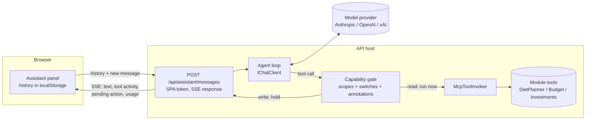
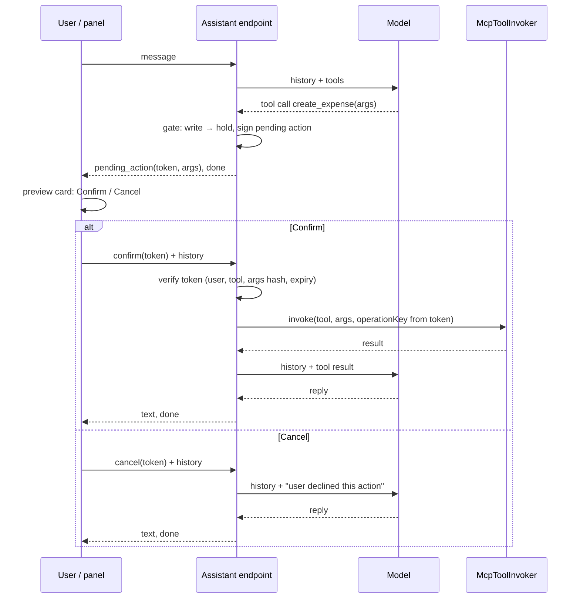

# In-app assistant — design

Status: **approved 2026-10-28**

Epic: [#634 — in-app assistant that acts through the MCP tools](https://github.com/piotrkantorowicz/home-system/issues/634)
Design issue: [#642](https://github.com/piotrkantorowicz/home-system/issues/642)
Prepared: 2026-10-28, against `origin/main` at `03e76324`.
Builds on: [MCP plan](../mcp/PLAN.md), [MCP auth](../mcp/AUTH.md), [MCP operations](../mcp/OPERATIONS.md).

## 1. Outcome

A signed-in user opens an assistant panel in the app and asks it, in plain language, to do
things there: answer questions about their diet, budget and investments; plan meals; add
products, recipes and expenses; import a week of meals. A low-cost model drives the same
tools the `/mcp` server exposes. **Nothing is written until the user confirms a preview card
in the panel.**

## 2. What already exists

| Evidence | Implication |
|---|---|
| `McpToolInvoker` + `McpToolUser` in `Shared.Infrastructure.Web` (#677, #720) | Every module tool runs in-process as a given `ClaimsPrincipal`: same catalog (`Tools` = `tools/list`), same methods, same results. The tool-layer decision is closed. |
| `McpToolInvoker` skips the MCP scope policies (noted in #677) | The assistant must decide itself which tools a user may run (§5). |
| Tools carry `[Authorize(Policy = <scope>)]` and `ReadOnly` / `Destructive` annotations (59 annotated tools) | Capabilities can be derived from metadata already on the tools; no new registry. |
| `Mcp:WritesEnabled` / `Mcp:ImportsEnabled` switches act "for every client" | The assistant honours them too. |
| `McpHosting.AddHomeSystemMcp` registers the MCP server and tools only when `Mcp:Enabled` is true | Tool registration has to be separated from exposing `/mcp` (§3.2). |
| `ImportPreviewTokens`: Data Protection token bound to subject + payload fingerprint, 30 min | Same pattern signs pending write actions (§6). |
| Operation keys + `operation_receipts` on every write tool | A confirmed action retried after a lost response replays instead of writing twice. |
| `Operations` module: `Api` + `Application`, no database | Precedent for a module without its own store. |
| Module-boundary architecture tests (#718) | A new `Assistant` module may reference `Shared` only, never another module's layers. |
| No Redis client in the backend (Redis serves Authentik only) | Usage counting does not get Redis "for free" (§8). |

## 3. Architecture

### 3.1 Overview

- **The agent runs in the backend.** The model API key never reaches the browser.
- **Tools are called in-process** through `McpToolInvoker`, as the signed-in user taken from
  the SPA token. `/mcp` stays for external clients (Claude Code) with its own token.
- **Stateless server.** The browser sends the conversation with every request; the server
  stores no conversation.

### 3.2 Placement

- **New module `Assistant`, one project `Assistant.Api`** (endpoint, loop, capability gate,
  provider registration) plus `Assistant.IntegrationTests`. It references `Shared.*` only, so
  the boundary tests pass without exceptions. No `Domain`, no database. Split out an
  `Application` project only if the loop grows logic that is worth testing without HTTP.
- **Host change:** tool registration (`AddMcpServer` + `AddInProcessToolCalls` + each module's
  `Add<Module>McpTools`) runs when `Mcp:Enabled` **or** `Assistant:Enabled` is true. Mapping
  `/mcp`, its auth scheme, Origin check and resource metadata stay behind `Mcp:Enabled` only.

### 3.3 Request and stream contract

`GET /api/assistant` — SPA bearer token; `{ provider }` when `Assistant:Enabled`, else 404. The
panel asks it first: 404 hides the panel, `provider` is shown in it (§11).

`POST /api/assistant/messages` — SPA bearer token, `Assistant:Enabled` else 404.

Request body: `messages` (the browser-held history, trimmed per §8), the new user message
(text, optional image per §10), the user's IANA time zone (from `Intl`), or instead a
`confirm` / `cancel` for a pending action (§6).

Response: `text/event-stream`, one JSON event per line:

| Event | Payload |
|---|---|
| `text` | Model text delta |
| `tool_call` | Tool name + short argument summary (shown as a line in the panel) |
| `tool_result` | Tool name + ok / error (results themselves go back to the model, not to the panel) |
| `pending_action` | Signed action token, tool name, arguments, `destructive` flag (§6) |
| `history` | The messages to append to browser storage for this turn (model text, tool calls and results), so the next request carries them |
| `usage` | Tokens used by this request and today's total vs budget |
| `error` | Readable message (limit hit, provider down, bad request) |
| `done` | End of turn |

The system prompt carries today's date in the user's time zone and the household context
the read tools expose; it is the same for every user apart from those values, so it caches.

## 4. Conversation storage

- History lives in the browser only, under a per-user key `home-system-assistant:`
  (auth subject from the ID token), one conversation per user per device; the panel has a
  clear action. No server persistence.
- **Sign-out clears it**, wherever sign-out runs (today `Sidebar` and `MoreSheet`), so the
  next person on a shared device never loads, or sends to the model, someone else's
  history. A Vitest case covers it: user A signs out, user B signs in, the panel starts
  empty.
- The server treats incoming history as **untrusted input**: a user who edits it only
  misleads their own model session, because tools still run as that user and every write
  still needs a server-signed pending action (§6).
- Logs record tool name, outcome, duration and token counts; never prompts, arguments,
  results or images (same rule as `HomeSystem.Mcp` call logging).

## 5. Tools and capabilities

Every tool in `McpToolInvoker.Tools` is a candidate. For each, the capability gate derives
the result below. **The gate fails closed:** a tool with no `[Authorize]` scope, or with any
scope the gate does not recognise, is **not offered**.

| Tool metadata | Result |
|---|---|
| No scope, or any unrecognised scope | **Not offered** |
| At least one scope, all of them `*:read`, and `ReadOnly = true` | **Run now** |
| Any write scope (`mcp:diet:write`, `mcp:investments:write`, Budget's write scope) | **Hold** for confirmation (§6) |
| Any `*:import` scope (`mcp:diet:import` today; every module's import scope) | **Hold**; offered only when `Mcp:WritesEnabled && Mcp:ImportsEnabled` |
| Write scope while `Mcp:WritesEnabled = false` | Not offered |
| `Destructive = true` | Held; card uses destructive styling |

- Bulk imports must carry an `*:import` scope so the switch reaches them, as
  `execute_plan_import` does and Budget's `execute_expense_import` does in #730
  (`BudgetMcp.WriteScope` + `BudgetMcp.ImportScope`).
- The signed-in user gets every grant implicitly; what a user may see or change is still
  enforced inside each tool and its handlers (household visibility, ownership), exactly as
  over `/mcp`.
- **Server-side refusal:** a call to a tool the gate does not offer is answered with a tool
  error and never reaches the invoker, whatever the model sends.
- **Guard test:** a test asserts, for every registered tool, that it has at least one scope,
  that every scope is one the gate recognises, and that scopes and annotations agree
  (read-only scopes ⇔ `ReadOnly = true`). A new tool missing `[Authorize]`, using an unknown
  scope or mis-annotated fails CI instead of being silently hidden or running unconfirmed.
- Delivery order follows the epic: #645 offered run-now tools only; #648 added held tools.

## 6. Write confirmation

- **Pending action token:** Data Protection payload with auth subject, tool name, the model's
  call id, the arguments themselves (server-generated operation key included) and an expiry
  (30 min, like preview tokens). Data Protection encrypts and authenticates the payload, so no
  separate argument hash is needed. Confirm runs exactly the arguments inside the token; the
  request carries only the token, so tampering cannot change what runs. The write switches are
  read again on confirm: a tool switched off since it was held does not run.
- **Request:** exactly one of `message`, `confirm` (token) or `cancel` (token), plus the
  history. While an action waits, the panel accepts no new message (the history ends with an
  unanswered call the provider would reject).
- **Operation key is minted when the action is held**, not at confirm: a double-click or a
  retried confirm replays the original receipt instead of writing twice. The server replaces
  any `operationKey` the model put in the arguments; models invent keys such as
  `skyr-naturalny-20261028` or a placeholder GUID, which would collide.
- **One pending action at a time.** If the model emits several write calls in one turn, the
  first is held and the rest are answered "confirm the previous action first"; the model
  re-proposes after the user decides.
- **Imports keep their own preview:** `preview_plan_import` is read-only and runs at once;
  its result (with `previewToken`) feeds the card for the held `execute_plan_import`.
- **Cancel** returns a tool result telling the model the user declined; nothing runs.
- Editing a pending action in the card is out of scope; the user corrects through chat.

## 7. Model providers

- The loop runs on `Microsoft.Extensions.AI` `IChatClient`. The official Anthropic C# SDK
  ships an `IChatClient` adapter (`AsIChatClient`); the OpenAI .NET SDK does too, and xAI
  exposes an OpenAI-compatible endpoint (`https://api.x.ai/v1`).
- **One provider and model per deployment**, read from configuration at startup. No per-user
  or per-conversation choice, no picker in the UI.
- The loop uses its own tool-calling cycle, not `UseFunctionInvocation()`, because held
  tools must stop the turn instead of executing.
- Prompt caching: Anthropic uses explicit cache control on the system prompt and tool
  definitions; OpenAI and xAI cache automatically, so their setting is a no-op.
- Delivery: #645 registers Anthropic only (default **Claude Haiku 5.5**); #732 adds OpenAI
  and xAI, with startup failing on an unknown provider or a missing key. Before #732 ships,
  confirm the xAI path against xAI's current docs (OpenAI client with a custom endpoint, or
  their native API).
- Local models (Ollama and similar) are out of scope for now.
- A test provider (`Fake`) returning scripted responses is registered only in
  `Development` / E2E configuration, for #650.

Configuration (`Assistant` section):

| Key | Default | Meaning |
|---|---|---|
| `Enabled` | `false` | Maps the endpoint; off → 404 and the panel is hidden. Stays off in production until #646 is merged. |
| `Provider` | `Anthropic` | `Anthropic`, `OpenAI`, `XAI` (`Fake` outside production) |
| `Model` | `claude-haiku-5-5` | Provider model id |
| `ApiKey` | — | Required when enabled; secret store / environment only |
| `BaseUrl` | provider default | Override, e.g. the xAI endpoint |
| `DailyTokenBudget` | `500000` | Input + output tokens per user per server day |
| `RequestsPerMinute` | `10` | Per user, fixed window |
| `MaxToolRounds` | `10` | Model ↔ tool round trips per request |
| `MaxOutputTokens` | `4096` | Per model call |
| `MaxHistoryTokens` | `20000` | Allowance for browser history (estimated as JSON length / 4); older turns are dropped |

## 8. Limits and cost (#646)

- **Daily token budget per user**, counted from the usage numbers `IChatClient` normalises
  across providers (input, output, cached input). Counted in tokens, not money, so no price
  table per model.
- **Store: in memory**, keyed by auth subject + date in the server's day (via `TimeProvider`).
  A restart resets counts, so the worst case is one extra daily budget per restart; the app
  runs as a single instance. Upgrade path: a small table if the host ever scales out.
  *(Rejected: Redis — new backend dependency for one counter; Postgres — a database and
  migrations for a module that otherwise has no store.)*
- **Hard ceiling outside the app:** set a monthly spend limit in the provider console. The
  in-app budget is the per-user fairness cap; the console limit is the bill cap.
- **Rate limit:** per auth subject, fixed one-minute window, counted next to the budget on the same
  `TimeProvider` (one 429 path, testable with a fake clock) rather than the ASP.NET rate limiter `/mcp` uses.
- **Runaway guards:** `MaxToolRounds` per request, `MaxOutputTokens` per call, request body
  size cap, history trimmed to the most recent turns that fit a fixed token allowance (older
  turns are dropped server-side before the model call).
- Over budget or over rate at the start of a request → 429 with a readable message,
  **without calling the model**. The panel shows today's usage from the `usage` event.
- **The budget is re-checked before every model call inside the loop**, not only once per
  request: one request can make up to `MaxToolRounds` calls, each resending the growing
  history. When the counter is exceeded mid-request, the loop stops and streams `error`
  then `done`. The overshoot is bounded by one model call per concurrent request, and a
  call that is aborted or fails mid-stream is still charged for the usage the provider had reported.
- **Cost estimate** (recorded at planning, 2026-10-25): about $3–6 per month for 4 active
  users on Haiku. Not re-checked against today's price list. #646 measures the real figure:
  one log line per request with token counts, summed per day.

## 9. Panel (#647)

- Opened from the app shell header; side panel on desktop, full-screen sheet on mobile.
- Streams text progressively; one line per tool call; preview cards for pending actions
  (#648); limit messages on 429.
- `en` and `pl` keys for every string; one language rendered at a time.
- Hidden when the endpoint reports the feature off.

## 10. Images (#649)

- Attach or take a photo in the panel; downscaled client-side.
- Server accepts JPEG / PNG / WebP up to a size cap, sends it as an image content block,
  and never stores it. The configured model must accept images; #649 checks this at startup
  or refuses attachments with a readable message.
- Enables #664 (receipt → expense) and, for text attachments, #731 (bank statement import).

## 11. Security and privacy

- **Data leaves the system.** When the assistant is enabled, everything the user's read
  tools return in a conversation (their meals, expenses, balances and what household members
  share with them) is sent to the configured provider. The owner enables the feature
  knowing this; the panel says which provider is used.
- **Prompt injection** through tool results (for example a shared recipe whose notes carry
  instructions) can at most make the model *propose* a write, which the user still has to
  confirm on a card that shows the real arguments.
- The model API key comes from configuration only and is never logged or sent to the browser.
- The SPA token never reaches `/mcp`; the MCP token never reaches the assistant endpoint.

## 12. Testing

- Integration tests with a fake `IChatClient` returning scripted tool calls; no live model
  calls in CI.
- Isolation: a second user's data never appears in the first user's tool results.
- Gate: held tools are not executed before confirm (zero rows written); tampered tokens and
  expired tokens are refused; cancel writes nothing.
- Guard test from §5 on every registered tool.
- E2E (#650): `Fake` provider scripted to plan a week; confirm the card; see the meals in
  the planner calendar, not marked eaten.

## 13. Decisions

| # | Decision | Status |
|---|---|---|
| D1 | Agent loop in the backend; API key server-side | Taken (epic) |
| D2 | Tools in-process via `McpToolInvoker`; `/mcp` only for external clients | Done (#677, #720) |
| D3 | Loop on `IChatClient`; providers Anthropic (default Haiku 5.5), OpenAI, xAI | Taken 2026-10-28 |
| D4 | One provider + model per deployment from configuration; no user choice | Taken 2026-10-28 |
| D5 | Per-user daily **token** budget from configuration | Taken 2026-10-25 |
| D6 | Conversations in browser storage only | Taken 2026-10-25 |
| D7 | New `Assistant` module, single `Assistant.Api` project, references `Shared` only | Taken 2026-10-28 |
| D8 | Tool registration decoupled from `/mcp` exposure (`Mcp:Enabled` or `Assistant:Enabled`) | Taken 2026-10-28 |
| D9 | Capabilities from tool scopes + annotations + existing switches; guard test keeps them consistent | Taken 2026-10-28 |
| D10 | Writes held as signed pending actions; operation key minted at hold; one pending action at a time | Taken 2026-10-28 |
| D11 | Usage counted in memory; provider console spend limit is the hard bill cap | Taken 2026-10-28 |
| D12 | Epic lane `epic/634-in-app-assistant-mcp-tools`: slices merge there and reach `main` together; `Assistant:Enabled` stays off until #646 | Taken 2026-10-28, revised the same day (was: no lane) |
| D13 | Sonnet opt-in for large plans deferred until #650 shows Haiku cannot build a week | Taken 2026-10-28 |
| D14 | Local models (Ollama) out of scope for this epic | Taken 2026-10-28 |

## 14. Delivery

| Issue | Slice | Depends on |
|---|---|---|
| [#642](https://github.com/piotrkantorowicz/home-system/issues/642) | This document | — |
| [#645](https://github.com/piotrkantorowicz/home-system/issues/645) | Agent loop, read-only tools, Anthropic, feature switch | #642 |
| [#646](https://github.com/piotrkantorowicz/home-system/issues/646) | Rate and token limits | #645 |
| [#647](https://github.com/piotrkantorowicz/home-system/issues/647) | Panel with streamed answers and tool activity | #645 |
| [#732](https://github.com/piotrkantorowicz/home-system/issues/732) | OpenAI and xAI providers | #645 |
| [#648](https://github.com/piotrkantorowicz/home-system/issues/648) | Confirm every write from a preview card | #647 |
| [#650](https://github.com/piotrkantorowicz/home-system/issues/650) | E2E: plan a week, confirm, see it in the planner | #648 |
| [#649](https://github.com/piotrkantorowicz/home-system/issues/649) | Image attachments | #647 |

Related, under [#640](https://github.com/piotrkantorowicz/home-system/issues/640):
[#664](https://github.com/piotrkantorowicz/home-system/issues/664) receipt photo → expense
(#649, #661), [#731](https://github.com/piotrkantorowicz/home-system/issues/731) bank
statement from an attachment (#649, #676).
